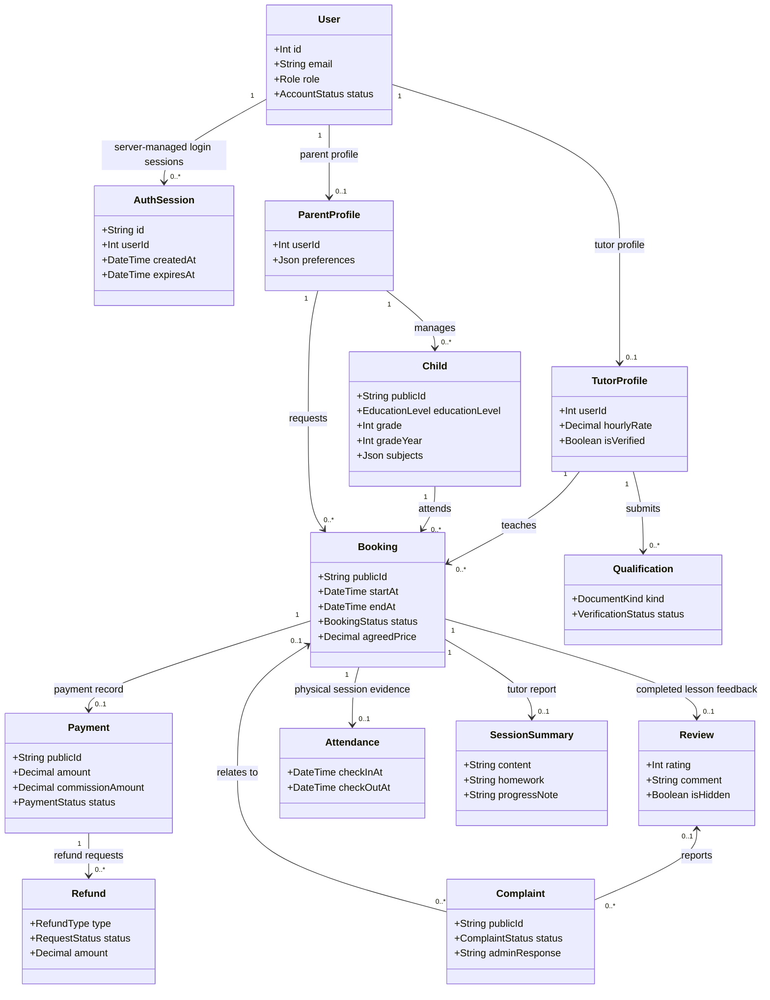
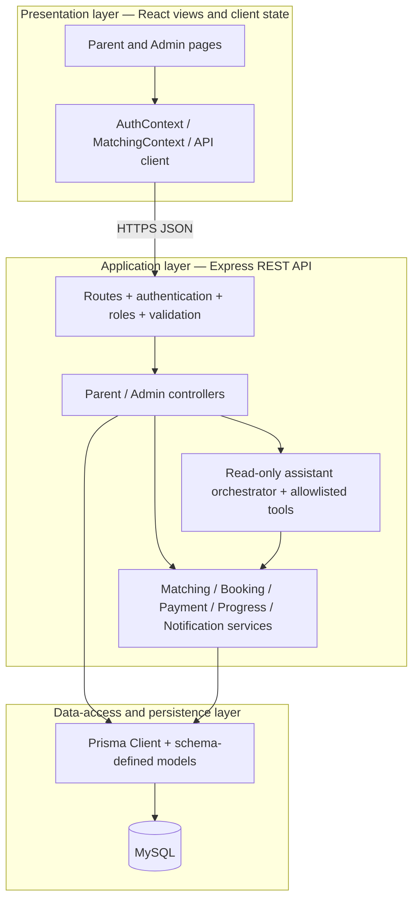

# WonderTutor current data model and domain class diagram

Schema snapshot: 12 November 2026, including review moderation, random public references and database-backed browser sessions. Source of truth: `backend/prisma/schema.prisma` and its migrations. This document describes the **declared schema**, not proof that every environment has applied its migrations. No production database was queried by this workstream. Yan Hsi's weekly-availability branch is not included in this snapshot.

13 November follow-up: the code now includes Yan Hsi's later integrations; the diagrams below remain the dated 12 November snapshot, not a regenerated complete ERD. The precise-location change adds one nullable scalar, `Booking.locationConfirmedAt DateTime?`, with no new table or relation. `Booking.location/latitude/longitude` now store a parent-confirmed per-booking physical venue. Null confirmation means legacy coordinates must not be used as a check-in destination. The migration deliberately does not backfill this timestamp. ParentProfile area coordinates retain their separate approximate matching purpose. See the latest follow-up in [review handover](REVIEW_HANDOVER_2026-11-12.md) for application rules.

View the exported diagrams: [full ERD](diagrams/current-erd.svg), [domain classes](diagrams/current-domain-classes.svg), and [application layers](diagrams/current-application-layers.svg). SVGs can be zoomed without losing text clarity; the Mermaid sources below remain editable.

## What the ERD currently looks like

There are **26 Prisma models/tables and 34 declared foreign-key relations**, shared by Parent, Tutor and Admin in one MySQL database. The central relationship is **ParentProfile → Child → Booking ← TutorProfile**. A Booking can have at most one Payment, Attendance, SessionSummary and Review. A Payment can have several Refund records. A Complaint can connect an involved user, a booking and now a reported review. Public references add four scalar columns; database-backed authentication adds AuthSession and its required User relationship.

| Area | Tables |
| --- | --- |
| Identity and parent data | User, AuthSession, EmailOtp, ParentProfile, Child, MatchingRequest, FavouriteTutor |
| Tutor information and scheduling | TutorProfile, TutorSubject, Qualification, PortfolioItem, AvailabilitySlot, AvailabilityException |
| Lessons and finance | Booking, RescheduleRequest, Payment, Refund, Attendance, SessionSummary, BankAccount, Withdrawal |
| Feedback and operations | Review, Complaint, AccountWarning, Notification, SystemSetting |

The ERD below includes every table and scalar field. PK = primary key, FK = a declared Prisma foreign-key relation, UK = a single-column unique constraint. `nullable` means optional. Composite constraints are described after the diagram, because marking each participating column individually “unique” would be misleading. Relationships are drawn only where Prisma actually declares them; an integer ending in `Id` does not automatically make it a foreign key.

```mermaid
erDiagram
  User ||--o{ AuthSession : "user (userId)"
  User ||--o| ParentProfile : "user (userId)"
  ParentProfile ||--o{ Child : "parent (parentId)"
  ParentProfile ||--o{ MatchingRequest : "parent (parentId)"
  ParentProfile ||--o{ FavouriteTutor : "parent (parentId)"
  TutorProfile ||--o{ FavouriteTutor : "tutor (tutorId)"
  User ||--o| TutorProfile : "user (userId)"
  TutorProfile ||--o{ TutorSubject : "tutor (tutorId)"
  TutorProfile ||--o{ Qualification : "tutor (tutorId)"
  TutorProfile ||--o{ PortfolioItem : "tutor (tutorId)"
  TutorProfile ||--o{ AvailabilitySlot : "tutor (tutorId)"
  TutorProfile ||--o{ BankAccount : "tutor (tutorId)"
  TutorProfile ||--o{ Withdrawal : "tutor (tutorId)"
  BankAccount ||--o{ Withdrawal : "bankAccount (bankAccountId)"
  ParentProfile ||--o{ Booking : "parent (parentId)"
  Child ||--o{ Booking : "child (childId)"
  TutorProfile ||--o{ Booking : "tutor (tutorId)"
  Booking ||--o{ RescheduleRequest : "booking (bookingId)"
  Booking ||--o| Payment : "booking (bookingId)"
  Payment ||--o{ Refund : "payment (paymentId)"
  Booking ||--o| Attendance : "booking (bookingId)"
  Booking ||--o| SessionSummary : "booking (bookingId)"
  Booking ||--o| Review : "booking (bookingId)"
  ParentProfile ||--o{ Review : "parent (parentId)"
  TutorProfile ||--o{ Review : "tutor (tutorId)"
  User ||--o{ Complaint : "filedBy (filedById)"
  User |o--o{ Complaint : "againstUser (againstUserId)"
  Booking |o--o{ Complaint : "booking (bookingId)"
  Review |o--o{ Complaint : "review (reviewId)"
  User |o--o{ Complaint : "handledBy (handledById)"
  User ||--o{ AccountWarning : "user (userId)"
  User ||--o{ AccountWarning : "issuedBy (issuedById)"
  User ||--o{ Notification : "user (userId)"
  TutorProfile ||--o{ AvailabilityException : "tutor (tutorId)"
  User {
    Int id PK
    String email UK
    String passwordHash "nullable"
    String googleId UK "nullable"
    Role role
    String fullName
    String phone "nullable"
    String profilePhotoUrl "nullable"
    Boolean isEmailVerified
    AccountStatus status
    DateTime privacyAcceptedAt "nullable"
    Boolean emailReminders
    DateTime deletedAt "nullable"
    DateTime createdAt
    DateTime updatedAt
  }
  AuthSession {
    String id PK "Char(64); SHA-256 session digest"
    Int userId FK
    String credentialTag "Char(43); credential binding"
    DateTime createdAt
    DateTime expiresAt
  }
  EmailOtp {
    Int id PK
    String email
    String codeHash
    DateTime expiresAt
    Int attempts
    DateTime createdAt
  }
  ParentProfile {
    Int id PK
    Int userId FK, UK
    String address "nullable"
    Float latitude "nullable"
    Float longitude "nullable"
    Json preferences "nullable"
  }
  Child {
    Int id PK
    String publicId UK "nullable; Char(36); UUIDv4 default"
    Int parentId FK
    String name
    EducationLevel educationLevel
    Int grade
    String subject "nullable"
    Json subjects "nullable"
    Int gradeYear "nullable"
    String preferredLanguage "nullable"
    String goals "nullable; Text"
    String notes "nullable; Text"
    String photoUrl "nullable"
    DateTime createdAt
  }
  MatchingRequest {
    Int id PK
    Int parentId FK
    Int childId "nullable"
    String source
    Json criteria
    Json results "nullable"
    DateTime createdAt
  }
  FavouriteTutor {
    Int parentId PK, FK
    Int tutorId PK, FK
  }
  TutorProfile {
    Int id PK
    Int userId FK, UK
    Gender gender "nullable"
    String emergencyContactName "nullable"
    String emergencyContactPhone "nullable"
    String bio "nullable; Text"
    String teachingApproach "nullable; Text"
    Json characteristics "nullable"
    Json languages "nullable"
    Json achievements "nullable"
    Int yearsExperience
    Decimal hourlyRate "Decimal(10, 2)"
    String location "nullable"
    Float latitude "nullable"
    Float longitude "nullable"
    Boolean offersPhysical
    Boolean offersOnline
    Decimal commissionRate "nullable; Decimal(5, 2)"
    Boolean isVerified
    DateTime verificationSubmittedAt "nullable"
    Float ratingAvg
    Int ratingCount
  }
  TutorSubject {
    Int id PK
    Int tutorId FK
    String subject
    EducationLevel educationLevel
    Int minGrade
    Int maxGrade
  }
  Qualification {
    Int id PK
    Int tutorId FK
    DocumentKind kind
    String title
    String institution "nullable"
    Int year "nullable"
    String documentUrl
    VerificationStatus status
    String reviewNote "nullable"
    DateTime createdAt
  }
  PortfolioItem {
    Int id PK
    Int tutorId FK
    String title
    String description "nullable; Text"
    String fileUrl
  }
  AvailabilitySlot {
    Int id PK
    Int tutorId FK
    Int dayOfWeek
    String startTime
    String endTime
  }
  BankAccount {
    Int id PK
    Int tutorId FK
    String bankName
    String accountName
    String accountNumber
    Boolean isDefault
  }
  Withdrawal {
    Int id PK
    Int tutorId FK
    Int bankAccountId FK
    Decimal amount "Decimal(10, 2)"
    RequestStatus status
    String rejectReason "nullable"
    Int reviewedById "nullable"
    DateTime createdAt
    DateTime reviewedAt "nullable"
  }
  Booking {
    Int id PK
    String publicId UK "nullable; Char(36); UUIDv4 default"
    Int parentId FK
    Int childId FK
    Int tutorId FK
    String subject
    DateTime startAt
    DateTime endAt
    TeachingMode teachingMode
    String location "nullable"
    Float latitude "nullable"
    Float longitude "nullable"
    String meetingLink "nullable"
    Boolean isTrial
    String messageToTutor "nullable; Text"
    Decimal proposedPrice "Decimal(10, 2)"
    Decimal counterPrice "nullable; Decimal(10, 2)"
    Decimal agreedPrice "nullable; Decimal(10, 2)"
    BookingStatus status
    String rejectionReason "nullable"
    String cancelReason "nullable"
    Int cancelledById "nullable"
    DateTime createdAt
    DateTime updatedAt
  }
  RescheduleRequest {
    Int id PK
    Int bookingId FK
    Int requestedById
    DateTime newStartAt
    DateTime newEndAt
    String reason "nullable"
    RequestStatus status
    DateTime createdAt
  }
  Payment {
    Int id PK
    String publicId UK "nullable; Char(36); UUIDv4 default"
    Int bookingId FK, UK
    Decimal amount "Decimal(10, 2)"
    Decimal commissionRate "Decimal(5, 2)"
    Decimal commissionAmount "Decimal(10, 2)"
    String method
    String gatewayRef "nullable"
    PaymentStatus status
    DateTime paidAt "nullable"
    DateTime createdAt
  }
  Refund {
    Int id PK
    Int paymentId FK
    Decimal amount "Decimal(10, 2)"
    RefundType type
    String reason
    RequestStatus status
    Int reviewedById "nullable"
    DateTime createdAt
    DateTime reviewedAt "nullable"
  }
  Attendance {
    Int id PK
    Int bookingId FK, UK
    DateTime checkInAt "nullable"
    Float checkInLat "nullable"
    Float checkInLng "nullable"
    Float checkInDistance "nullable"
    String checkInPhotoUrl "nullable"
    DateTime checkOutAt "nullable"
    Float checkOutLat "nullable"
    Float checkOutLng "nullable"
  }
  SessionSummary {
    Int id PK
    Int bookingId FK, UK
    String content "Text"
    String progressNote "nullable; Text"
    String topics "nullable; Text"
    String homework "nullable; Text"
    String recommendations "nullable; Text"
    DateTime createdAt
  }
  Review {
    Int id PK
    Int bookingId FK, UK
    Int parentId FK
    Int tutorId FK
    Int rating
    String comment "nullable; Text"
    String photoUrl "nullable"
    Boolean isHidden
    String moderationReason "nullable; Text"
    DateTime moderatedAt "nullable"
    Int moderatedById "nullable"
    DateTime createdAt
  }
  Complaint {
    Int id PK
    String publicId UK "nullable; Char(36); UUIDv4 default"
    Int filedById FK
    Int againstUserId FK "nullable"
    Int bookingId FK "nullable"
    Int reviewId FK "nullable"
    String category
    String description "Text"
    String evidenceUrl "nullable"
    ComplaintStatus status
    String adminResponse "nullable; Text"
    Int handledById FK "nullable"
    DateTime createdAt
    DateTime updatedAt
  }
  AccountWarning {
    Int id PK
    Int userId FK
    Int issuedById FK
    String reason "Text"
    Int complaintId "nullable"
    DateTime createdAt
  }
  Notification {
    Int id PK
    Int userId FK
    String type
    String title
    String message "Text"
    String link "nullable"
    Boolean isRead
    DateTime createdAt
  }
  SystemSetting {
    String key PK
    String value
    DateTime updatedAt
  }
  AvailabilityException {
    Int id PK
    Int tutorId FK
    String date "VarChar(10)"
    Json ranges
  }
```

## Integrity details to explain in the report

- `Child.publicId`, `Booking.publicId`, `Payment.publicId` and `Complaint.publicId` are unique, nullable `CHAR(36)` columns with Prisma `uuid()` defaults for newly created rows. Existing rows are filled by an idempotent application script using Node `crypto.randomUUID()`. Nullable columns allow a staged deployment; null references fall back to the numeric ID until backfill finishes. The integer `id` primary keys and all existing foreign keys remain unchanged.
- Public references reduce predictable URL enumeration; they are identifiers, not passwords or access grants. Parent routes still require authentication, the Parent role and ownership checks; Admin complaint routes still require the Admin role. Valid legacy numeric references remain accepted during the compatibility transition. See [public-ID rollout and routes](PUBLIC_IDS_2026-11-12.md).
- `User.email` and optional `googleId` are unique. ParentProfile and TutorProfile each have a unique `userId`; both relations are optional from User. The role/profile consistency rule is enforced by application logic, not by a database XOR constraint. Admin accounts normally have neither profile.
- `AuthSession.id` stores a SHA-256 digest of an opaque cookie credential, never the raw session cookie. Its required User foreign key cascades on physical User deletion; `userId` and `expiresAt` have indexes. Expiry, credential binding and current User status are checked in the API, while successful logout deletes that session. CSRF tokens and anonymous seed cookies are not additional database tables. See [session security and rollout](SAFER_SESSIONS_2026-11-12.md).
- `FavouriteTutor` has a **composite primary key** `(parentId, tutorId)`, preventing the same parent from saving the same tutor twice.
- `AvailabilityException` has a **composite unique constraint** `(tutorId, date)`. Its JSON `ranges` replace weekly AvailabilitySlot hours for one date; an empty array means unavailable all day.
- `Payment.bookingId`, `Attendance.bookingId`, `SessionSummary.bookingId` and `Review.bookingId` are each unique. This enforces at most one of each record per booking, not a guarantee that a record already exists.
- `Complaint` has a **composite unique constraint** `(filedById, reviewId)` for review reports. Null `reviewId` allows unrelated complaint rows; reported-review deletion sets the optional relation to null.
- `Review.isHidden`, `moderationReason`, `moderatedAt` and scalar `moderatedById` preserve a moderation decision. Hiding is an application visibility decision; it is not deletion of the original review. Public reads/aggregates must consistently respect the moderation rule.
- **Scalar references without a declared foreign key:** MatchingRequest.childId; Booking.cancelledById; RescheduleRequest.requestedById; Withdrawal.reviewedById; Refund.reviewedById; Review.moderatedById; AccountWarning.complaintId. Their IDs must not be shown as enforced FK relationships in a physical ERD. Audit references can become stale unless application rules preserve their targets.
- `EmailOtp.email` has an index, not a User foreign key. SystemSetting is a key/value table with no declared relations.
- Monetary values use Prisma Decimal and MySQL DECIMAL (amounts 10,2; commission rates 5,2). Keep decimals through calculations and convert only at DTO boundaries.
- JSON columns (preferences, subjects, criteria/results, characteristics/languages/achievements, date-specific ranges) are flexible structured data, not additional relational tables. Keep validation/versioning in the API.
- `Child.subject` is a legacy first-subject mirror of `subjects`. Both must stay synchronized. `Booking.isTrial` is retained for historical compatibility; new bookings reject trial requests under the current product decision.
- Multiple selected lesson slots become multiple Booking rows in one transaction. No recurring-booking, subscription, BookingBatch or group-class table exists.
- Account deletion is implemented as anonymization/deactivation with operational blockers and retained lesson/payment history. It is not universal physical deletion or a complete free-text/cloud-retention policy.
- The LLM assistant's current conversations and search context are held in process memory. They are **not** database tables. Guided matching stores MatchingRequest; read-only LLM searches intentionally do not.
- The public FAQ reads maintained approved policy content in code; it does not require an invented FAQ table or an Admin CMS that has not been built.

## Is a class diagram needed?

Use the ERD for the physical database. A domain class diagram is useful for Chapter4 if the rubric asks for one, but do not pretend the project contains PHP/Java entity classes or one model class per controller. These are Prisma-defined domain entities plus Express controller/service modules and React views. The following is a deliberately smaller **domain view**; it omits database plumbing already shown above and does not declare inheritance that does not exist in the code.

Methods such as “book lesson” belong to controller/service modules rather than being invented as methods on the Prisma Booking entity. If the report needs implementation detail, show the actual responsibility flow:

This is **three logical layers with an MVC-style separation**, implemented as a modular monolith. React supplies the view; Express controllers handle HTTP interactions; services contain reusable business rules; Prisma schema/client and persisted entities provide the data model. Controllers currently also call Prisma directly, so do not claim that every database access passes through a repository/service abstraction. `frontend/` and `backend/` folder names do not contradict layering.

Hostinger is the deployment target, not a logical application layer. One deployment can serve all three portals plus `/admin/login`. Whether Node and MySQL share a physical host must be drawn from the actual Hostinger plan/configuration; no hPanel/server inspection was performed here. External Gemini, Cloudinary, email and Billplz are services outside the database, not extra application entity tables.

## Diagram maintenance

Apply the moderation, public-ID and `20261112160000_cookie_sessions` authentication-session migrations through the normal reviewed release procedure. The public-ID deployment also runs `backend/scripts/backfill-public-ids.js` after migration and Prisma Client generation; see the rollout documents before deploying. Do not manually change production tables from this diagram. Re-generate/update this document whenever `schema.prisma` changes. Record any additional migration and update the 26-table/34-relation counts if a model or declared relation is added or removed. Use a domain class diagram for concepts and a deployment diagram for actual machines/processes; they answer different questions.
